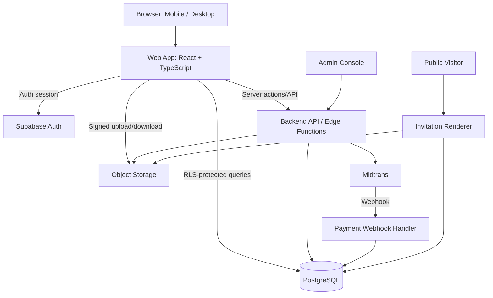

# SYSTEM ARCHITECTURE — JANJI KITA
**Versi:** 1.0 | **Status:** Final baseline teknis | **Tanggal:** 22 November 2026

## 1. Tujuan dan Batas
Dokumen ini menerjemahkan PRD Janji Kita menjadi arsitektur implementasi. Teknologi rekomendasi awal: React + TypeScript + Vite + Tailwind untuk web; Supabase Auth/Postgres/Storage untuk fondasi backend; Vercel untuk web hosting. Pemakaian provider harus tetap dapat diganti. Free tier diprioritaskan, tetapi kapasitas dan batas paket gratis wajib diuji; jangan menganggap gratis berarti tanpa batas.

## 2. Gambaran Sistem

## 3. Logical Components
### Web application
- Public marketing and template marketplace.
- Authenticated customer dashboard.
- Invitation editor.
- Admin control center.
- Reseller workspace.
- Public invitation renderer at `/i/:slug`.
- Responsive component system and localization.

### Backend/API
Backend owns all privileged business decisions:
- Price calculation and order creation.
- Midtrans transaction creation and webhook verification.
- Publish/expiry/renewal entitlement.
- Collaborator authorization.
- Template publication and versioning.
- Signed media URLs and upload validation.
- Reseller attribution and reporting.
- Admin operations, audit logging, and analytics aggregation.

Browser must never hold service-role keys, Midtrans server keys, or unrestricted storage credentials.

### Database
PostgreSQL stores relational business data, metadata, settings, content JSON documents, and audit records. Avoid storing large media blobs in relational rows.

### Object storage
Separate buckets or logical namespaces:
- `user-uploads-private`: original/private uploads.
- `invitation-public-assets`: optimized assets referenced by published versions.
- `template-assets`: approved marketplace assets.
- `temporary-imports`: expiring import files.
Use private-by-default access, MIME/signature validation, size limits, randomized object keys, signed URLs, and lifecycle cleanup.

### Payment gateway
Midtrans is the initial target. Gateway integration is isolated behind a payment adapter so another provider can be added without changing order domain logic.

## 4. Frontend Structure
Suggested modules:
- `app/` routing, providers, auth guard.
- `features/auth/`
- `features/marketplace/`
- `features/invitations/`
- `features/editor/`
- `features/guests/`
- `features/orders/`
- `features/reseller/`
- `features/admin/`
- `shared/ui/`, `shared/api/`, `shared/i18n/`, `shared/validation/`.
Use route-level lazy loading. Editor and public renderer should be separate bundles where practical. Avoid loading heavy editor libraries on public invitation pages.

## 5. Invitation Document and Rendering
An invitation is a versioned document:
- `invitation` contains ownership, slug, status, active window, and current published version pointer.
- `invitation_versions` contains immutable content/schema snapshots.
- Draft version can change repeatedly.
- Published version is immutable; update creates a new version and swaps pointer atomically.
- Public renderer reads only the current published version when status is active and current time is within active window.
- Renderer validates schema version and uses allowlisted components only.
- Unknown component types fail safely and are logged; never execute arbitrary script from document JSON.

## 6. Editor Runtime
Use a structured document model, not arbitrary DOM persistence. Components are typed nodes with IDs, parent/child relationships, props, style tokens, responsive overrides, and asset references.
- Editor state is client-side and persisted through autosave.
- Autosave writes draft revisions with optimistic concurrency (`version_number` / `updated_at`).
- Conflicting writes must prompt recovery or merge strategy; do not silently overwrite.
- Drag/drop and transform operations must obey viewport/safe-area constraints.
- Undo/redo uses command history locally; periodic durable snapshots prevent loss.
- Published renderer consumes normalized schema, not editor runtime state.

## 7. API Boundaries
All privileged actions use server-side functions/endpoints:
- `create_order(invitation_id, add_on_ids, coupon_code, payer_context)`
- `create_payment_session(order_id)`
- `payment_webhook(provider_payload)`
- `publish_invitation(invitation_id, draft_version_id)`
- `extend_invitation(invitation_id, order_id)`
- `create_signed_upload_url(file_metadata)`
- `finalize_upload(upload_id)`
- `invite_collaborator(invitation_id, email, role)`
- `record_rsvp(invitation_slug, guest_token, response)`
- `check_in(ticket_token, operator_context)`
- `admin_update_configuration(key, value)`
Endpoint names are conceptual contracts, not claims that code already exists. Enforce authentication, authorization, schema validation, idempotency where relevant, and audit.

## 8. Payment Lifecycle
1. Browser requests server-side order creation.
2. Backend loads authoritative template/add-on prices and entitlement.
3. Backend calculates immutable order snapshot.
4. Backend creates Midtrans payment session using server credentials.
5. Browser receives only safe checkout token/redirect data.
6. Gateway sends webhook.
7. Webhook handler validates signature and verifies status with gateway when required.
8. Transaction is processed idempotently.
9. Successful payment creates/updates entitlement and publication window in a DB transaction.
10. User receives status update.
Never activate publication based only on a browser redirect.

## 9. Scheduled Tasks
Required scheduled jobs:
- Expire invitations whose active_until has passed.
- Reconcile pending payments with gateway.
- Clean temporary imports and abandoned uploads.
- Clean expired signed artifacts where applicable.
- Aggregate analytics.
- Detect orphaned assets and failed processing.
Jobs must be idempotent and observable. If free hosting lacks reliable scheduled execution, use a provider-supported scheduler or an external low-cost scheduler behind a feature/config switch.

## 10. Security Architecture
- Supabase Auth or equivalent identity provider.
- RLS on user-facing tables; server-side service role only in trusted backend.
- Role checks and invitation membership checks on every protected operation.
- Rate limiting on auth, RSVP, guestbook, upload, checkout, and public endpoints.
- Upload allowlist, MIME sniffing, file size/duration caps, randomized names, scanning where available.
- HTML sanitization; CSS allowlist; no arbitrary JS.
- CSP, secure cookies/session handling, CSRF protection where applicable.
- Secrets in deployment secret store.
- Audit logs for admin, payment, role, consent, and publication actions.
- Backup, restore, incident and key rotation procedures.

## 11. Performance and Reliability
- Lazy-load editor panels, fonts, galleries, video, and animation.
- Responsive image variants and modern formats.
- CDN caching for public immutable assets.
- Public page cache keyed by published version; invalidate on publish.
- Do not cache private guest or RSVP data publicly.
- Autosave debounce plus explicit save state.
- Retry transient network failures with idempotency.
- Graceful degraded mode if optional integration is unavailable.
- Monitor Core Web Vitals, renderer errors, webhook lag, DB errors, storage usage, and job failures.

## 12. Environments and Deployment
Environments: local, staging, production; separate Supabase projects or isolated DB/storage per environment. Never point staging at production by default.
- Vercel preview deployments for branches/PRs.
- Production deploy from protected main branch after CI.
- Environment variables documented in `.env.example`; never commit secrets.
- DB migrations versioned and applied before app code that depends on them.
- Backward-compatible migrations; destructive changes require backup and explicit approval.
- Smoke test auth, template browse, draft save, checkout sandbox, webhook, publish, expiry, and public render.

## 13. Cost Strategy
Start with free tiers for domain-adjacent services only where limits fit actual use. Track DB size, storage, egress, function execution, build minutes, and email/provider usage. Set budget alerts and hard quotas. Do not enable paid APIs, premium font libraries, or paid media pipelines without owner approval. The domain is the only planned upfront cost; any additional paid service requires explicit approval.

## 14. Architecture Decisions
- Structured invitation schema over free-form HTML.
- Immutable published versions.
- Backend-authoritative prices and entitlement.
- Payment provider adapter.
- Private-by-default uploads.
- Path-based public URL `/i/{slug}`.
- No arbitrary JavaScript in user designs.
- Feature flags for integrations with uncertain API availability.
